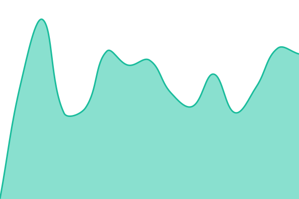
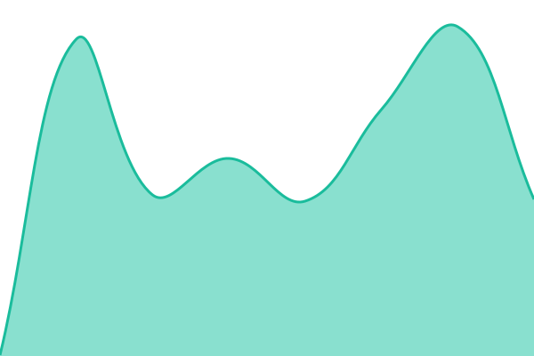

# [📈 Live Status](https://status.requitynetworks.com): <!--live status--> **🟩 All systems operational**

This repository contains the open-source uptime monitor and status page for [dmpumwire](https://status.requitynetworks.com), powered by [Upptime](https://github.com/upptime/upptime).

With [Upptime](https://upptime.js.org), you can get your own unlimited and free uptime monitor and status page, powered entirely by a GitHub repository. We use [Issues](https://github.com/dmpumwire/upptime/issues) as incident reports, [Actions](https://github.com/dmpumwire/upptime/actions) as uptime monitors, and [Pages](https://status.requitynetworks.com) for the status page.

<!--start: status pages-->
<!-- This summary is generated by Upptime (https://github.com/upptime/upptime) -->
<!-- Do not edit this manually, your changes will be overwritten -->
<!-- prettier-ignore -->
| URL | Status | History | Response Time | Uptime |
| --- | ------ | ------- | ------------- | ------ |
|  [FMS Production](https://fms.requitytrack.com) | 🟩 Up | [fms-production.yml](https://github.com/dmpumwire/upptime/commits/HEAD/history/fms-production.yml) | 

 475ms
     
 | 

<a href="https://status.requitynetworks.com/history/fms-production">100.00%</a>
    

|  [UNEB EREG](https://ereg.uneb.ac.ug) | 🟩 Up | [uneb-ereg.yml](https://github.com/dmpumwire/upptime/commits/HEAD/history/uneb-ereg.yml) | 

 520ms
     
 | 

<a href="https://status.requitynetworks.com/history/uneb-ereg">100.00%</a>
    

|  [OMS Production](https://app.qfu.co.ug/) | 🟩 Up | [oms-production.yml](https://github.com/dmpumwire/upptime/commits/HEAD/history/oms-production.yml) | 

 497ms
     
 | 

<a href="https://status.requitynetworks.com/history/oms-production">100.00%</a>
    

<!--end: status pages-->

[**Visit our status website →**](https://status.requitynetworks.com)

## 📄 License

- Powered by: [Upptime](https://github.com/upptime/upptime)
- Code: [MIT](./LICENSE) © [Anand Chowdhary](https://anandchowdhary.com)
- Data in the `./history` directory: [Open Database License](https://opendatacommons.org/licenses/odbl/1-0/)
